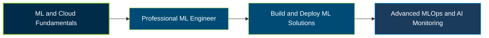

# Google Cloud Professional Machine Learning Engineer Certification Exam Guide

A dedicated, comprehensive study guide and technical reference repository for candidates preparing for the **Google Cloud Professional Machine Learning Engineer Certification Exam**, covering AI architecture, model development, deployment, and MLOps.

---

## Exam Overview

The Google Cloud Professional Machine Learning Engineer certification validates the ability to build, evaluate, deploy, scale, and monitor machine learning and generative AI solutions using Google Cloud technologies.

- **Exam Format**: Multiple-choice and multiple-select questions; online-proctored or onsite-proctored.
- **Target Audience**: Machine Learning Engineers, AI Engineers, Data Scientists, ML Platform Engineers, and cloud professionals.
- **Prerequisites**: None; Google recommends 3+ years of industry experience, including 1+ year designing and managing Google Cloud solutions.

---

## Core Exam Domains & Knowledge Areas

### 1. Architecting Low-Code AI Solutions

- Develop machine learning models using BigQuery ML and AutoML.
- Select appropriate AI APIs and foundation models for business requirements.
- Build and optimize AI applications for cost, latency, and availability.

### 2. Collaborating Within and Across Teams to Manage Data and Models

- Explore, preprocess, and manage structured and unstructured data for ML.
- Prototype models using notebooks, common frameworks, and foundation models.
- Evaluate experiments and track model artifacts, versions, and lineage.

### 3. Scaling Prototypes into ML Models

- Select model architectures and deployment strategies based on requirements.
- Train, fine-tune, and tune models using appropriate data and compute resources.
- Choose hardware and distributed training approaches, including GPUs and TPUs.

### 4. Serving and Scaling Models

- Deploy models for batch and online inference using suitable Google Cloud services.
- Package, version, and roll out models with strategies such as A/B testing and canary deployments.
- Scale model-serving infrastructure and optimize production performance.

### 5. Automating and Orchestrating ML Pipelines

- Build and orchestrate end-to-end ML pipelines with data and model validation.
- Maintain consistent preprocessing between training and serving.
- Automate retraining and implement CI/CD/CT workflows for ML systems.

### 6. Monitoring AI Solutions

- Secure AI systems against data exposure, malicious prompting, and model risks.
- Apply responsible AI practices, model explainability, and production monitoring.
- Detect data drift, concept drift, training-serving skew, and other operational issues.

---

## Certification Path

The following is a suggested learning progression, not an official prerequisite or successor certification pathway.

---

## Recommended Practice & Study Resources

Combine official Google Cloud exam materials with supplementary practice and hands-on machine learning work to strengthen exam readiness.

- **CertsGate**: Explore [Google Professional Machine Learning Engineer exam preparation resources](https://certsgate.com/exams/google/professional-machine-learning-engineer) for supplementary study materials and practice questions.
- **Google Cloud Documentation**: Use the [Google Cloud documentation](https://cloud.google.com/docs) to explore AI services, model development, deployment, monitoring, and operational best practices.
